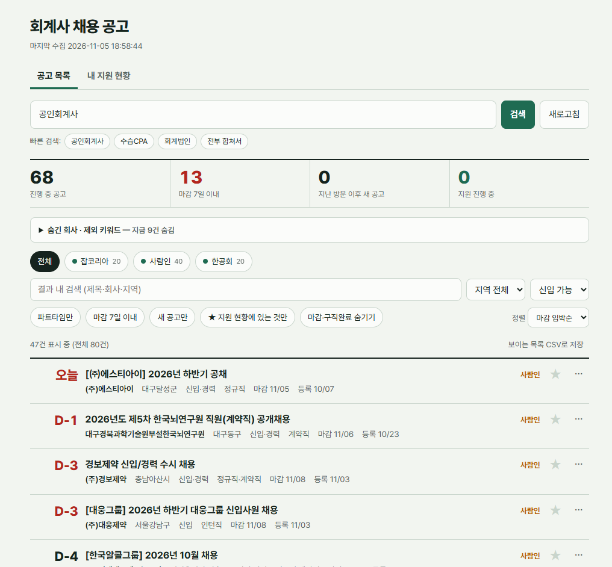

# 회계·세무 채용공고 통합 대시보드

잡코리아 · 사람인 · 인크루트 · 알바몬 · 고용24 · 한국공인회계사회(수습CPA 구인게시판)의
회계사 · 회계/세무 사무 · 인턴 · 단기 알바 공고를 한 화면에 모아 보고, 지원 현황까지 관리하는 개인용 웹 대시보드입니다.



## 주요 기능

**공고 모아 보기**
- 6개 사이트를 동시에 수집하고, 사이트 간 중복 공고는 하나로 합칩니다
- 여러 키워드 한 번에 검색 (`공인회계사, 회계 인턴, 세무 알바`)
- 빠른 검색 버튼: 기본 · 회계사 · 회계·세무 사무 · 알바·단기 · 인턴
- 근무형태 구분: 공고마다 **인턴 / 알바·단기 / 파트타임** 표시, 골라 보기 가능
- 급여가 있는 공고(알바몬 · 고용24)는 급여도 함께 표시
- 마감일을 D-day로 표시하고 마감 임박순 · 최근 등록순 등으로 정렬
- 필터: 출처, 지역, 경력(신입 가능/경력직), 근무형태, 마감 7일 이내, 새 공고, 마감·구직완료 숨기기, 결과 내 검색
- 지난 방문 이후 새로 올라온 공고에 NEW 표시
- 특정 회사 숨기기, 제외 키워드 (예: 'CPA 마케터'처럼 광고 쪽 CPA 공고, 수강생 모집 광고 걸러내기)

**지원 현황 관리**
- 공고별 상태 관리: 관심 → 지원예정 → 지원완료 → 서류합격 → 면접 → 최종합격/불합격
- 공고마다 메모 (자동 저장)
- 사이트에서 공고가 내려가도 지원 현황에는 그대로 남음
- 마감일 캘린더 파일(.ics) 내보내기: 구글·아웃룩 캘린더에 넣으면 마감 하루 전에 알림
- 지원 현황 · 공고 목록을 엑셀(CSV)로 저장

## 기술 스택

| 구분 | 사용 기술 |
|---|---|
| 백엔드 | Python, FastAPI, SQLite |
| 수집 | requests + BeautifulSoup (잡코리아·사람인·인크루트·고용24), Next.js 페이지 데이터 파싱 (알바몬), Playwright 헤드리스 크롬 (한공회) |
| 프론트엔드 | HTML · CSS · 순수 JavaScript (빌드 도구 없음), 다크 모드 · 모바일 대응 |

한공회 구인게시판은 주소가 바뀌지 않는 iframe 구조라서 일반 요청으로는 목록을 읽을 수 없습니다.
그래서 헤드리스 크롬으로 사이트 자체의 메뉴 이동 함수를 호출해 게시판을 연 뒤 표를 읽습니다.

사이트별로 검색 품질을 맞추기 위한 처리도 들어 있습니다.
- 고용24: 본문까지 검색하면 무관한 공고가 많아 **제목 검색**만 사용
- 알바몬: 모든 공고가 알바라서 키워드의 '알바'는 빼고 검색하고, 업직종이 사무·회계 계열인 공고만 남김
  ('○○세무서점' 같은 식당 공고 제외)
- 지역 표기 통일: '경상남도'와 '경남'처럼 사이트마다 다른 표기를 같은 지역으로 묶음

## 실행 방법

```bash
pip install -r requirements.txt
python -m playwright install chromium   # 한공회 수집용, 최초 1회
uvicorn app:app
```

브라우저에서 http://127.0.0.1:8000 을 엽니다. Windows에서는 `start.bat`을 더블클릭해도 됩니다.

- 수집 결과는 10분 동안 캐시되며, 화면의 **새로고침** 버튼으로 바로 다시 수집할 수 있습니다.
- 지원 현황 · 메모 · 설정은 `data.db`(SQLite)에 저장됩니다. 개인 데이터라 저장소에는 올리지 않습니다.
- 한공회 수집이 실패하면 `python kicpa_debug.py`로 크롬 창을 띄워 과정을 직접 확인할 수 있습니다.

## 파일 구성

```
app.py            수집기 · API 서버 (FastAPI)
static/index.html 대시보드 화면
kicpa_debug.py    한공회 수집 진단 도구
start.bat         Windows 실행 파일
docs/             README용 화면 캡처
```

## 참고

개인 구직용으로 만든 도구입니다. 각 사이트의 공고 저작권은 해당 사이트와 게시자에게 있으며,
수집 주기를 짧게 두지 않고 결과를 캐시해 사이트에 부담을 주지 않도록 했습니다.
